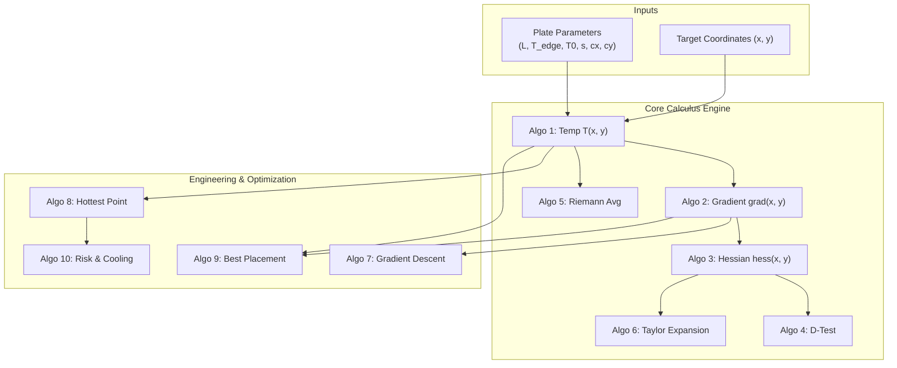
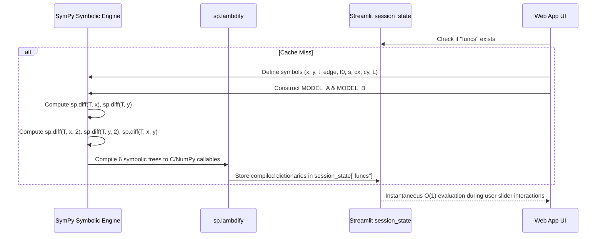

# CalSymPy: Algorithms & Pseudocode Specification (`PSEUDOCODE.md`)

> **Course**: MAT 112 Engineering Mathematics & Python Programming  
> **Team 4 (Delta-T)**: Circuit Board Thermal Distribution & Multivariable Calculus  
> **Role**: Pseudocode & Algorithm Formulation (Advitiya Sharma / Team 4)  
> **Modules**: [`calsympy.py`](file:///E:/Study/Projects/calsympy_v2/calsympy.py) (Math Engine) & [`app.py`](file:///E:/Study/Projects/calsympy_v2/app.py) (Web Interface)

---

## Table of Contents

1. [Architectural Overview & Complexity Summary](#1-architectural-overview--complexity-summary)
2. [Algorithm 1: Thermal Surface Evaluation (Models A & B)](#algorithm-1-thermal-surface-evaluation-models-a--b)
3. [Algorithm 2: First Partial Derivatives & Gradient Vector](#algorithm-2-first-partial-derivatives--gradient-vector)
4. [Algorithm 3: Second Partial Derivatives & Hessian Matrix](#algorithm-3-second-partial-derivatives--hessian-matrix)
5. [Algorithm 4: Second Derivative Test & Critical Point Classification](#algorithm-4-second-derivative-test--critical-point-classification)
6. [Algorithm 5: 2D Midpoint Riemann Sum Double Integral](#algorithm-5-2d-midpoint-riemann-sum-double-integral)
7. [Algorithm 6: Multivariable Taylor Approximations (Degrees 1 & 2)](#algorithm-6-multivariable-taylor-approximations-degrees-1--2)
8. [Algorithm 7: Normalized Downhill Gradient Descent with Margin Clamping](#algorithm-7-normalized-downhill-gradient-descent-with-margin-clamping)
9. [Algorithm 8: Global Grid Search for Peak Temperature](#algorithm-8-global-grid-search-for-peak-temperature)
10. [Algorithm 9: Constrained Safe Component Relocation](#algorithm-9-constrained-safe-component-relocation)
11. [Algorithm 10: Thermal Risk Assessment & Cooling Advisor](#algorithm-10-thermal-risk-assessment--cooling-advisor)
12. [Algorithm 11: Symbolic Differentiation & Lambdification Pipeline](#algorithm-11-symbolic-differentiation--lambdification-pipeline)

---

## 1. Architectural Overview & Complexity Summary

CalSymPy models two-dimensional steady-state heat distribution on a square circuit board of side length $L = 4.0\text{ cm}$ spanning $[0, L] \times [0, L]$.



### Complexity Reference Table

| Algorithm | Primary Task | Time Complexity | Space Complexity | Real Benchmarks ($L=4\text{ cm}$) |
|:---|:---|:---:|:---:|:---|
| **1. Temp** | Temperature at point $(x, y)$ | $\mathcal{O}(1)$ | $\mathcal{O}(1)$ | Model A: $T(2, 2) = 85.0^\circ\text{C}$ |
| **2. Grad** | First partials $\langle T_x, T_y \rangle$ & magnitude | $\mathcal{O}(1)$ | $\mathcal{O}(1)$ | Model A: $\|\nabla T(3, 2)\| = 36.39^\circ\text{C/cm}$ |
| **3. Hessian** | Second partials $(T_{xx}, T_{yy}, T_{xy})$ | $\mathcal{O}(1)$ | $\mathcal{O}(1)$ | Model A: $T_{xx}(2, 2) = -60.0^\circ\text{C/cm}^2$ |
| **4. D-Test** | Classify critical point via $D$ | $\mathcal{O}(1)$ | $\mathcal{O}(1)$ | Model A: $D(2, 2) = +3600 \to \text{Max}$ |
| **5. Riemann Avg** | 2D Double Integral over plate | $\mathcal{O}(n^2)$ | $\mathcal{O}(1)$ | $n=80 \implies 6,400\text{ evals} \to 46.47^\circ\text{C}$ |
| **6. Taylor** | Linear $L(x,y)$ & Quadratic $Q(x,y)$ | $\mathcal{O}(1)$ | $\mathcal{O}(1)$ | Error at $\Delta x = 0.1\text{ cm} < 0.001^\circ\text{C}$ |
| **7. Descent** | Downhill chip relocation | $\mathcal{O}(K)$ | $\mathcal{O}(K)$ | $K=40\text{ steps} \to \text{Ends at } [0.2, 0.2]$ |
| **8. Hottest** | Global peak coordinate search | $\mathcal{O}(N^2)$ | $\mathcal{O}(1)$ | $N=50 \implies 2,601\text{ evals} \to (2, 2)$ |
| **9. Placement** | Safe haven optimization ($<70^\circ\text{C}$) | $\mathcal{O}(N^2)$ | $\mathcal{O}(1)$ | $N=60 \implies 3,721\text{ nodes} \to (1.46, 1.46)$ |
| **10. Risk/Cool** | Thresholding & delta remediation | $\mathcal{O}(1)$ | $\mathcal{O}(1)$ | Peak $85^\circ\text{C} \implies \text{Drop } 15.1^\circ\text{C}$ |
| **11. SymPy** | Symbolic diff & lambdify | $\mathcal{O}(1)\text{ (compiled)}$ | $\mathcal{O}(1)$ | Memoized in `st.session_state` |

---

## Algorithm 1: Thermal Surface Evaluation (Models A & B)

### Objective
Evaluate steady-state surface temperature $T(x, y)$ in degrees Celsius at coordinates $(x, y) \in [0, L] \times [0, L]$.

### Mathematical Formulations
- **Model A (Gaussian Hotspot with Bell-Curve Decay)**:
  $$r^2 = (x - c_x)^2 + (y - c_y)^2$$
  $$T(x, y) = T_{\text{edge}} + T_0 \cdot \exp\left(-\frac{r^2}{s}\right)$$
- **Model B (Sinusoidal Standing Wave with Cooled Edges)**:
  $$k = \frac{\pi}{L}$$
  $$T(x, y) = T_{\text{edge}} + T_0 \cdot \sin(k \cdot x) \cdot \sin(k \cdot y)$$

### Pseudocode
```text
ALGORITHM EvaluateTemperature(plate, x, y):
    INPUT:
        plate: Object containing (model, L, t_edge, t0, s, cx, cy)
        x: Float, horizontal coordinate in cm
        y: Float, vertical coordinate in cm
    OUTPUT:
        T: Float, temperature in degrees Celsius

    IF plate.model == "A" THEN
        r2 <- (x - plate.cx)^2 + (y - plate.cy)^2
        T <- plate.t_edge + plate.t0 * EXP(-r2 / plate.s)
        RETURN T
    ELSE
        k <- PI / plate.L
        T <- plate.t_edge + plate.t0 * SIN(k * x) * SIN(k * y)
        RETURN T
    END IF
END ALGORITHM
```

---

## Algorithm 2: First Partial Derivatives & Gradient Vector

### Objective
Compute the temperature rate of change along both axes ($T_x = \frac{\partial T}{\partial x}$, $T_y = \frac{\partial T}{\partial y}$), the complete gradient vector $\nabla T$, and its Euclidean magnitude $\|\nabla T\|$.

### Mathematical Formulations
- **Model A (Chain Rule)**:
  $$\frac{\partial r^2}{\partial x} = 2(x - c_x) \implies T_x = -2 \frac{T_0}{s}(x - c_x)\exp\left(-\frac{r^2}{s}\right) = \frac{-2(x - c_x)}{s} \cdot [T(x, y) - T_{\text{edge}}]$$
  $$\frac{\partial r^2}{\partial y} = 2(y - c_y) \implies T_y = -2 \frac{T_0}{s}(y - c_y)\exp\left(-\frac{r^2}{s}\right) = \frac{-2(y - c_y)}{s} \cdot [T(x, y) - T_{\text{edge}}]$$
- **Model B (Trigonometric Partials with $k = \pi/L$)**:
  $$T_x = T_0 \cdot k \cdot \cos(k \cdot x) \cdot \sin(k \cdot y)$$
  $$T_y = T_0 \cdot k \cdot \sin(k \cdot x) \cdot \cos(k \cdot y)$$
- **Gradient Vector & Magnitude**:
  $$\nabla T = \langle T_x, T_y \rangle, \quad \|\nabla T\| = \sqrt{T_x^2 + T_y^2}$$

### Pseudocode
```text
ALGORITHM ComputeGradient(plate, x, y):
    INPUT:
        plate: Object containing model parameters
        x, y: Coordinates on plate
    OUTPUT:
        tx: Float, dT/dx (rate of temperature change in x)
        ty: Float, dT/dy (rate of temperature change in y)
        mag: Float, ||grad T|| (steepest rate of ascent)

    IF plate.model == "A" THEN
        factor <- (EvaluateTemperature(plate, x, y) - plate.t_edge) * (-2.0 / plate.s)
        tx <- factor * (x - plate.cx)
        ty <- factor * (y - plate.cy)
    ELSE
        k <- PI / plate.L
        tx <- plate.t0 * k * COS(k * x) * SIN(k * y)
        ty <- plate.t0 * k * SIN(k * x) * COS(k * y)
    END IF

    mag <- SQRT(tx^2 + ty^2)
    RETURN tx, ty, mag
END ALGORITHM
```

---

## Algorithm 3: Second Partial Derivatives & Hessian Matrix

### Objective
Determine surface curvature and diagonal twisting across the plate:
$$\mathbf{H} = \begin{bmatrix} T_{xx} & T_{xy} \\ T_{xy} & T_{yy} \end{bmatrix} = \begin{bmatrix} \frac{\partial^2 T}{\partial x^2} & \frac{\partial^2 T}{\partial x \partial y} \\ \frac{\partial^2 T}{\partial y \partial x} & \frac{\partial^2 T}{\partial y^2} \end{bmatrix}$$

### Mathematical Formulations
- **Model A (Product Rule on First Partials)**:
  Let $E = T(x, y) - T_{\text{edge}} = T_0 \exp(-r^2/s)$, $\Delta x = x - c_x$, $\Delta y = y - c_y$:
  $$T_{xx} = E \cdot \left[ \frac{4 \Delta x^2}{s^2} - \frac{2}{s} \right]$$
  $$T_{yy} = E \cdot \left[ \frac{4 \Delta y^2}{s^2} - \frac{2}{s} \right]$$
  $$T_{xy} = E \cdot \left[ \frac{4 \Delta x \Delta y}{s^2} \right]$$
- **Model B (Harmonic Sine/Cosine Derivatives)**:
  $$T_{xx} = -T_0 \cdot k^2 \cdot \sin(k \cdot x) \sin(k \cdot y)$$
  $$T_{yy} = -T_0 \cdot k^2 \cdot \sin(k \cdot x) \sin(k \cdot y)$$
  $$T_{xy} = T_0 \cdot k^2 \cdot \cos(k \cdot x) \cos(k \cdot y)$$

### Pseudocode
```text
ALGORITHM ComputeHessian(plate, x, y):
    INPUT:
        plate: Object containing model parameters
        x, y: Coordinates on plate
    OUTPUT:
        txx: Float, d2T/dx2 (x-axis curvature)
        tyy: Float, d2T/dy2 (y-axis curvature)
        txy: Float, d2T/dxdy (cross/diagonal curvature)

    IF plate.model == "A" THEN
        E <- EvaluateTemperature(plate, x, y) - plate.t_edge
        dx <- x - plate.cx
        dy <- y - plate.cy
        s <- plate.s
        txx <- E * (4.0 * (dx^2) / (s^2) - 2.0 / s)
        tyy <- E * (4.0 * (dy^2) / (s^2) - 2.0 / s)
        txy <- E * (4.0 * dx * dy / (s^2))
    ELSE
        k <- PI / plate.L
        txx <- -plate.t0 * (k^2) * SIN(k * x) * SIN(k * y)
        tyy <- txx
        txy <- plate.t0 * (k^2) * COS(k * x) * COS(k * y)
    END IF

    RETURN txx, tyy, txy
END ALGORITHM
```

---

## Algorithm 4: Second Derivative Test & Critical Point Classification

### Objective
Calculate the Hessian discriminant $D$ and classify the local surface geometry at critical points where $\nabla T \approx \mathbf{0}$.

### Mathematical Rules
$$D = \det(\mathbf{H}) = T_{xx} \cdot T_{yy} - (T_{xy})^2$$
1. **Critical Point Verification**: Test is physically and mathematically valid only when $\|\nabla T\| < 0.01\text{ C/cm}$.
2. **Tolerance Check**: If $|D| < 10^{-6}$, return `"Inconclusive"` (handles numerical precision round-off).
3. **Local Maximum (Hotspot Peak)**: $D > 0$ and $T_{xx} < 0$.
4. **Local Minimum (Cooling Well)**: $D > 0$ and $T_{xx} > 0$.
5. **Saddle Point (Mountain Pass)**: $D < 0$.

### Pseudocode
```text
ALGORITHM SecondDerivativeTest(plate, x, y):
    INPUT:
        plate: Object containing thermal parameters
        x, y: Coordinates on plate
    OUTPUT:
        D: Float, Hessian discriminant
        classification: String indicating geometric nature

    txx, tyy, txy <- ComputeHessian(plate, x, y)
    D <- (txx * tyy) - (txy^2)

    IF ABS(D) < 1e-6 THEN
        classification <- "Inconclusive"
    ELSE IF D < 0.0 THEN
        classification <- "Saddle Point"
    ELSE IF txx < 0.0 THEN
        classification <- "Local Maximum"
    ELSE
        classification <- "Local Minimum"
    END IF

    RETURN D, classification
END ALGORITHM
```

---

## Algorithm 5: 2D Midpoint Riemann Sum Double Integral

### Objective
Approximate the plate's spatial average temperature over the area $[0, L] \times [0, L]$ via numerical double integration:
$$T_{\text{avg}} = \frac{1}{L^2} \iint_{\text{Plate}} T(x, y) \, dA \approx \frac{1}{L^2} \sum_{i=0}^{n-1} \sum_{j=0}^{n-1} T(x_i^*, y_j^*) \cdot \Delta x \cdot \Delta y$$

### Discretization Parameters
- Sub-interval width: $\Delta x = \Delta y = \frac{L}{n}$ (for $n = 80$, $\Delta x = 0.05\text{ cm}$)
- Cell area: $\Delta A = \Delta x^2 = 0.0025\text{ cm}^2$
- Midpoint evaluation coordinates:
  $$x_i^* = (i + 0.5) \cdot \Delta x, \quad y_j^* = (j + 0.5) \cdot \Delta y$$

### Pseudocode
```text
ALGORITHM AverageTemperature(plate, n = 80):
    INPUT:
        plate: Object containing geometry (L) and model
        n: Integer, grid discretization resolution per axis
    OUTPUT:
        avg_temp: Float, spatial average temperature in C

    dx <- plate.L / n
    total <- 0.0

    FOR i FROM 0 TO (n - 1) DO
        x_mid <- (i + 0.5) * dx
        FOR j FROM 0 TO (n - 1) DO
            y_mid <- (j + 0.5) * dx
            cell_temp <- EvaluateTemperature(plate, x_mid, y_mid)
            total <- total + (cell_temp * dx * dx)
        END FOR
    END FOR

    avg_temp <- total / (plate.L^2)
    RETURN avg_temp
END ALGORITHM
```

---

## Algorithm 6: Multivariable Taylor Approximations (Degrees 1 & 2)

### Objective
Compute linear and quadratic polynomial approximations of $T(x, y)$ in the local neighborhood of an operating point $(a, b)$.

### Mathematical Formulations
- **Degree 1 (Tangent Plane)**:
  $$L(x, y) = T(a, b) + T_x(a, b) \cdot (x - a) + T_y(a, b) \cdot (y - b)$$
- **Degree 2 (Quadratic Taylor Polynomial)**:
  $$Q(x, y) = L(x, y) + \frac{1}{2} T_{xx}(a, b)(x - a)^2 + T_{xy}(a, b)(x - a)(y - b) + \frac{1}{2} T_{yy}(a, b)(y - b)^2$$

### Pseudocode
```text
ALGORITHM TangentPlane(plate, a, b, x, y):
    INPUT: plate, expansion center (a, b), query point (x, y)
    OUTPUT: Linear approximation L(x, y)

    tx, ty, _ <- ComputeGradient(plate, a, b)
    t_base <- EvaluateTemperature(plate, a, b)
    RETURN t_base + tx * (x - a) + ty * (y - b)
END ALGORITHM

ALGORITHM TaylorDegree2(plate, a, b, x, y):
    INPUT: plate, expansion center (a, b), query point (x, y)
    OUTPUT: Quadratic approximation Q(x, y)

    linear_approx <- TangentPlane(plate, a, b, x, y)
    txx, tyy, txy <- ComputeHessian(plate, a, b)
    dx <- x - a
    dy <- y - b

    curvature_correction <- 0.5 * txx * (dx^2) + txy * dx * dy + 0.5 * tyy * (dy^2)
    RETURN linear_approx + curvature_correction
END ALGORITHM
```

---

## Algorithm 7: Normalized Downhill Gradient Descent with Margin Clamping

### Objective
Relocate an overheating microchip downhill along the steepest negative gradient path $-\nabla T$, ensuring the chip remains safely inside circuit board margins $[0.2, L - 0.2]$.

### Downhill Kinematics
1. **Unit Downhill Direction**:
   $$\mathbf{u} = -\frac{\nabla T(x_k, y_k)}{\|\nabla T(x_k, y_k)\|}$$
2. **Step Update**:
   $$x_{k+1} = x_k + \eta \cdot u_x, \quad y_{k+1} = y_k + \eta \cdot u_y \quad (\text{where step size } \eta = 0.1\text{ cm})$$
3. **Safety Clamping**:
   $$x_{k+1} = \max(0.2, \min(L - 0.2, x_{k+1}))$$
   $$y_{k+1} = \max(0.2, \min(L - 0.2, y_{k+1}))$$

### Pseudocode
```text
ALGORITHM GradientDescent(plate, start_x, start_y, step = 0.1, max_steps = 40):
    INPUT:
        plate: Plate object
        start_x, start_y: Initial component coordinates
        step: Step size in cm (default 0.1)
        max_steps: Iteration limit (default 40)
    OUTPUT:
        path: List of (x, y) coordinate tuples
        final_temp: Float, temperature at final resting coordinate

    curr_x <- start_x
    curr_y <- start_y
    path <- [(curr_x, curr_y)]

    FOR step_idx FROM 1 TO max_steps DO
        tx, ty, mag <- ComputeGradient(plate, curr_x, curr_y)
        
        IF mag > 0.0 THEN
            curr_x <- curr_x - step * (tx / mag)
            curr_y <- curr_y - step * (ty / mag)
        END IF

        // Clamping to physical board margins
        curr_x <- MAX(0.2, MIN(plate.L - 0.2, curr_x))
        curr_y <- MAX(0.2, MIN(plate.L - 0.2, curr_y))

        path.APPEND((curr_x, curr_y))
    END FOR

    final_temp <- EvaluateTemperature(plate, curr_x, curr_y)
    RETURN path, final_temp
END ALGORITHM
```

---

## Algorithm 8: Global Grid Search for Peak Temperature

### Objective
Perform an exhaustive discrete grid scan across $[0, L] \times [0, L]$ to locate the global hotspot peak coordinate and its maximum temperature.

### Discretization
- Grid intervals: $n = 50$ divisions per axis $\implies (50 + 1) \times (50 + 1) = 2,601$ inspection nodes.
- Grid spacing: $\Delta x = \frac{L}{n} = 0.08\text{ cm}$.

### Pseudocode
```text
ALGORITHM FindHottestPoint(plate, n = 50):
    INPUT:
        plate: Object containing geometry L and thermal formulas
        n: Integer grid division count
    OUTPUT:
        best_x: Coordinate of maximum temperature
        best_y: Coordinate of maximum temperature
        max_t: Peak temperature value in C

    best_x <- 0.0
    best_y <- 0.0
    max_t <- -1000.0

    FOR i FROM 0 TO n DO
        x <- i * (plate.L / n)
        FOR j FROM 0 TO n DO
            y <- j * (plate.L / n)
            t <- EvaluateTemperature(plate, x, y)
            IF t > max_t THEN
                max_t <- t
                best_x <- x
                best_y <- y
            END IF
        END FOR
    END FOR

    RETURN best_x, best_y, max_t
END ALGORITHM
```

---

## Algorithm 9: Constrained Safe Component Relocation

### Objective
Find the nearest coordinate $(x^*, y^*)$ to the initial position $(x_0, y_0)$ that satisfies safe operating thermal criteria:
$$\min_{(x, y)} \sqrt{(x - x_0)^2 + (y - y_0)^2} \quad \text{subject to} \quad T(x, y) < T_{\text{limit}} \quad \text{and} \quad 0.2 \le x, y \le L - 0.2$$

### Discretization
- Resolution: $n = 60 \implies 61 \times 61 = 3,721$ candidate nodes.
- Spanning region: $[0.2, L - 0.2]$ with step size $\Delta = \frac{L - 0.4}{n}$.

### Pseudocode
```text
ALGORITHM FindBestPlacement(plate, x0, y0, limit = 70.0, n = 60):
    INPUT:
        plate: Plate object
        x0, y0: Initial component coordinates
        limit: Safe temperature threshold (default 70.0 C)
        n: Grid resolution
    OUTPUT:
        Tuple: (best_x, best_y, temp_at_best, displacement) OR None

    // Immediate satisfaction check
    t_start <- EvaluateTemperature(plate, x0, y0)
    IF t_start < limit THEN
        RETURN x0, y0, t_start, 0.0
    END IF

    best_node <- NULL
    step_size <- (plate.L - 0.4) / n

    FOR i FROM 0 TO n DO
        x <- 0.2 + (i * step_size)
        FOR j FROM 0 TO n DO
            y <- 0.2 + (j * step_size)
            t <- EvaluateTemperature(plate, x, y)
            
            IF t < limit THEN
                dist <- SQRT((x - x0)^2 + (y - y0)^2)
                IF best_node IS NULL OR dist < best_node.displacement THEN
                    best_node <- (x, y, t, dist)
                END IF
            END IF
        END FOR
    END FOR

    RETURN best_node
END ALGORITHM
```

---

## Algorithm 10: Thermal Risk Assessment & Cooling Advisor

### Objective
Categorize peak temperature according to electronics reliability thresholds and compute quantitative cooling recommendations.

### Threshold Rules
- **Low Risk ($T < 70^\circ\text{C}$)**: Safe continuous operation.
- **Medium Risk ($70^\circ\text{C} \le T \le 90^\circ\text{C}$)**: Thermal throttling zone; requires edge cooling or heatsink.
- **High Risk ($T > 90^\circ\text{C}$)**: Critical junction temperature; permanent silicon degradation danger.

### Pseudocode
```text
ALGORITHM GetRiskLevel(t):
    INPUT: t (Temperature in C)
    OUTPUT: String ("Low", "Medium", "High")

    IF t < 70.0 THEN
        RETURN "Low"
    ELSE IF t <= 90.0 THEN
        RETURN "Medium"
    ELSE
        RETURN "High"
    END IF
END ALGORITHM

ALGORITHM CoolingSuggestions(peak_temp):
    INPUT: peak_temp (Highest recorded temperature on plate)
    OUTPUT: List of actionable engineering tips

    IF peak_temp < 70.0 THEN
        RETURN ["Temperature is safe; no action needed."]
    END IF

    drop <- ROUND(peak_temp - 69.9, 1)
    tips <- [
        "Peak must fall by " + STRING(drop) + " C to reach Low risk.",
        "Option 1: reduce the chip heating T0 by " + STRING(drop) + " C.",
        "Option 2: cool the plate edges (T_edge) by " + STRING(drop) + " C."
    ]

    IF peak_temp > 90.0 THEN
        tips.APPEND("Add a heat sink or fan, or move heat-sensitive parts away from the hotspot.")
    END IF

    RETURN tips
END ALGORITHM
```

---

## Algorithm 11: Symbolic Differentiation & Lambdification Pipeline

### Objective
Automate multivariable symbolic calculus via SymPy in `app.py`, compiling symbolic derivatives into vectorized NumPy callables and memoizing them in session state.

### Symbolic Execution Graph


### Pseudocode
```text
ALGORITHM CompileModel(symbolic_expression, symbols_tuple):
    INPUT:
        symbolic_expression: SymPy mathematical expression T(x, y, ...)
        symbols_tuple: Tuple of SymPy symbols (X, Y, TE, T0, S, CX, CY, SIDE)
    OUTPUT:
        List of 6 compiled vectorized numerical functions:
        [T_fn, Tx_fn, Ty_fn, Txx_fn, Tyy_fn, Txy_fn]

    expr_tx  <- SymPy.diff(symbolic_expression, X)
    expr_ty  <- SymPy.diff(symbolic_expression, Y)
    expr_txx <- SymPy.diff(symbolic_expression, X, 2)
    expr_tyy <- SymPy.diff(symbolic_expression, Y, 2)
    expr_txy <- SymPy.diff(symbolic_expression, X, Y)

    compiled_list <- EMPTY_LIST
    FOR EACH expr IN [symbolic_expression, expr_tx, expr_ty, expr_txx, expr_tyy, expr_txy] DO
        fn <- SymPy.lambdify(symbols_tuple, expr, "numpy")
        compiled_list.APPEND(fn)
    END FOR

    RETURN compiled_list
END ALGORITHM
```

---

*Authored for CalSymPy • MAT 112 Engineering Mathematics & Python Programming*
