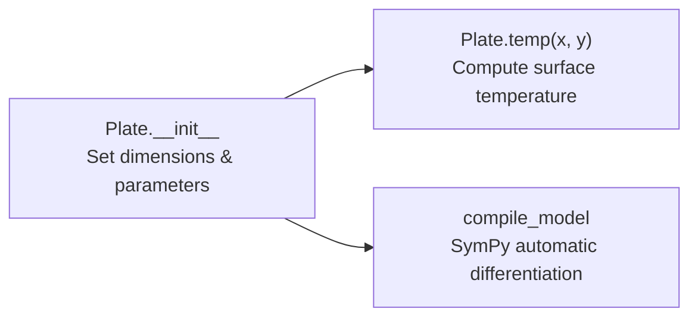
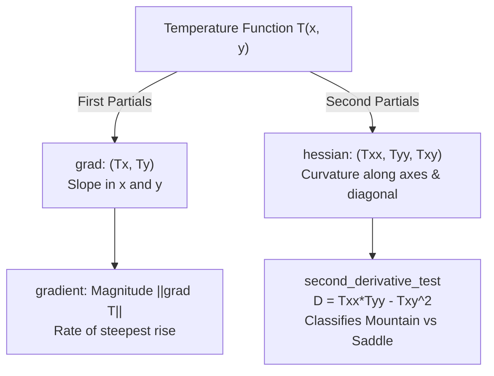
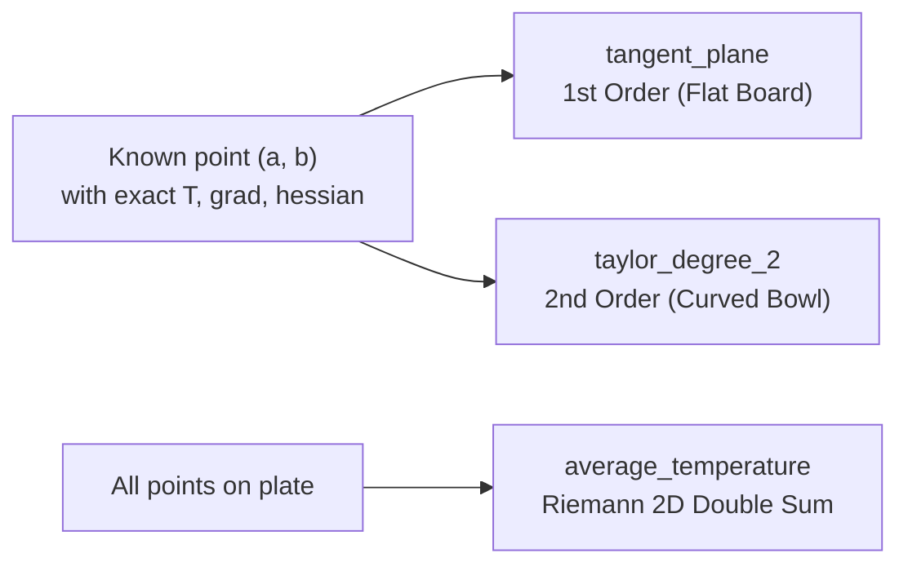
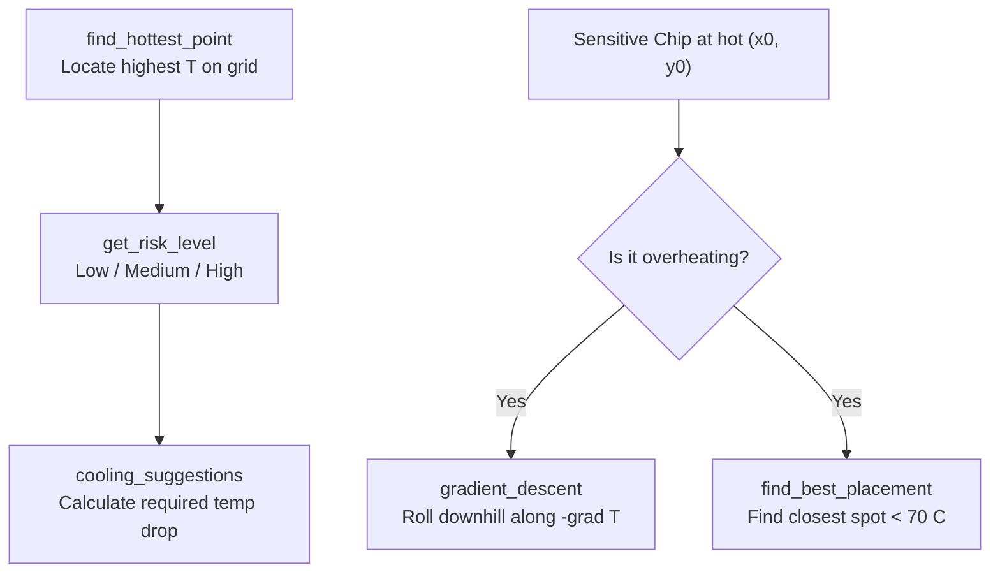

# CalSymPy Function Reference Guide (`functions.md`)
> **"Explain Like I'm Five" Edition — From Circuit Boards to Multivariable Calculus**
>
> **Project**: CalSymPy (MAT 112 Engineering Mathematics & Python Programming)  
> **Core Files**: [`calsympy.py`](file:///E:/Study/Projects/calsympy_v2/calsympy.py) (Calculations Engine) & [`app.py`](file:///E:/Study/Projects/calsympy_v2/app.py) (Interactive Web App)

---

## Table of Contents

1. [Big Picture: What is CalSymPy?](#1-big-picture-what-is-calsympy)
2. [Quick Reference Cheat Sheet](#2-quick-reference-cheat-sheet)
3. [The Circuit Plate Setup](#3-the-circuit-plate-setup)
   - [`Plate.__init__`](#plate__init__) — *Setting up the board*
   - [`Plate.temp`](#platetemp) — *The digital thermometer*
   - [`compile_model`](#compile_model) — *The SymPy robot algebraist*
4. [Measuring Slope & Curvature (Calculus Tools)](#4-measuring-slope--curvature-calculus-tools)
   - [`Plate.grad`](#plategrad) — *Which way is uphill?*
   - [`gradient`](#gradient) — *The heat speedometer*
   - [`Plate.hessian`](#platehessian) — *Measuring surface bending*
   - [`second_derivative_test`](#second_derivative_test) — *Peak, bowl, or Pringles chip?*
5. [Approximating Surfaces & Global Metrics](#5-approximating-surfaces--global-metrics)
   - [`tangent_plane`](#tangent_plane) — *The flat cardboard sheet*
   - [`taylor_degree_2`](#taylor_degree_2) — *The curved bowl hugging the hill*
   - [`average_temperature`](#average_temperature) — *The grid sheet-cake slicer (Riemann Sum)*
6. [Thermal Management & Relocation (Engineering Actions)](#6-thermal-management--relocation-engineering-actions)
   - [`find_hottest_point`](#find_hottest_point) — *The radar scan for danger*
   - [`get_risk_level`](#get_risk_level) — *The traffic light thermal alarm*
   - [`cooling_suggestions`](#cooling_suggestions) — *The engineer's triage checklist*
   - [`gradient_descent`](#gradient_descent) — *The rolling marble chip escape*
   - [`find_best_placement`](#find_best_placement) — *The safe house locator*
7. [Visualizing the Heat Map](#7-visualizing-the-heat-map)
   - [`draw_map`](#draw_map) — *The thermal imaging camera*
8. [Summary & Takeaways](#8-summary--takeaways)

---

## 1. Big Picture: What is CalSymPy?

Imagine your laptop or smartphone playing a graphics-heavy game. Under the hood, the processor chip gets blazing hot, while the metallic edges of the chassis stay relatively cool.

If a sensitive electronic part is placed too close to that fiery central chip, it will overheat, throttle, or burn out.

**CalSymPy** simulates a square circuit board of side length $L = 4\text{ cm}$. It lets engineers:
1. **Map out temperatures** across every square millimeter of the board.
2. **Use multivariable calculus** to find how quickly temperatures rise or fall in different directions.
3. **Automatically move sensitive components** away from dangerous hotspots to safe, cool zones.

---

## 2. Quick Reference Cheat Sheet

| # | Function / Method | Plain English Analogy | Key Formula / Concept | What it Returns |
|:---|:---|:---|:---|:---|
| 1 | `Plate.__init__` | Building the physical circuit board | $L=4\text{ cm}$, $T_{\text{edge}}$, $T_0$, center $(c_x, c_y)$ | New `Plate` object |
| 2 | `Plate.temp` | Digital infrared thermometer | $T(x, y)$ (Gaussian bell or 2D sine wave) | Temperature ($^\circ\text{C}$) |
| 3 | `compile_model` | SymPy doing your homework algebra | Symbolic `sp.diff` converted via `lambdify` | Fast numerical functions |
| 4 | `Plate.grad` | Looking around to see which way is uphill | Partial derivatives $\langle T_x, T_y \rangle$ | Tuple: $(T_x, T_y)$ in $^\circ\text{C/cm}$ |
| 5 | `gradient` | Heat direction + speed reading | $\nabla T = \langle T_x, T_y \rangle$, $\|\nabla T\| = \sqrt{T_x^2 + T_y^2}$ | Tuple: $(T_x, T_y, \|\nabla T\|)$ |
| 6 | `Plate.hessian` | Feeling the bowl or dome curve | Second partials $T_{xx}, T_{yy}, T_{xy}$ | Tuple: $(T_{xx}, T_{yy}, T_{xy})$ |
| 7 | `second_derivative_test` | Peak, valley, or Pringles saddle? | Discriminant $D = T_{xx}T_{yy} - (T_{xy})^2$ | Tuple: $(D, \text{"Local Max / Saddle / ..."} )$ |
| 8 | `tangent_plane` | Resting a flat cardboard sheet on a dome | $L(x, y) = T(a, b) + T_x\Delta x + T_y\Delta y$ | Linear temperature estimate |
| 9 | `taylor_degree_2` | Bending a flexible bowl against a dome | $Q(x, y) = L(x, y) + \frac{1}{2}T_{xx}\Delta x^2 + \dots$ | Quadratic temperature estimate |
| 10 | `average_temperature` | Slicing sheet cake into 6,400 tiny cubes | 2D Midpoint Riemann Double Sum | Overall board average ($^\circ\text{C}$) |
| 11 | `find_hottest_point` | Radar sweeping the whole board | Scanning an $N \times N$ grid for maximum $T$ | $(x, y, T_{\text{max}})$ |
| 12 | `get_risk_level` | Traffic light warning for heat | Green ($<70^\circ$), Yellow ($70\text{--}90^\circ$), Red ($>90^\circ$) | String: `"Low"`, `"Medium"`, `"High"` |
| 13 | `cooling_suggestions` | Emergency troubleshooting checklist | Calculate needed temperature drop $\Delta T$ | List of bullet-point tips |
| 14 | `gradient_descent` | Rolling a marble downhill to the cold edge | $x_{\text{new}} = x - \text{step} \times \frac{T_x}{\|\nabla T\|}$ | Path of points + final temp |
| 15 | `find_best_placement` | Finding the nearest safe haven | Closest spot below $70^\circ\text{C}$ with safety margin | $(x, y, T, \text{distance})$ |
| 16 | `draw_map` | Heat-vision thermal camera | Heatmap contour + start/end dots | Visual Matplotlib plot |

---

## 3. The Circuit Plate Setup



### `Plate.__init__`
**"Setting up the circuit board"**

#### Normie Explanation
Think of this as unboxing a blank electronic board. You decide how big the board is, where the hot microchip sits, and what room temperature or edge-cooling is applied.

#### Why Do We Need It?
Real hardware comes in different sizes and configurations. Some boards have a single hot GPU in the middle (Model A), while others have a distributed wave-like heating pattern with cold outer edges (Model B).

#### How It Works (The Code)
```python
def __init__(self, model="A", t_edge=None, t0=None, s=2.0, cx=2.0, cy=2.0, L=4.0):
    self.model, self.s, self.cx, self.cy, self.L = model, s, cx, cy, L
    self.t_edge = t_edge if t_edge is not None else (25.0 if model == "A" else 20.0)
    self.t0 = t0 if t0 is not None else (60.0 if model == "A" else 50.0)
```
- **$L$**: The side length of the square board in centimeters (default $4.0\text{ cm}$).
- **$T_{\text{edge}}$**: The temperature at the borders of the board.
- **$T_0$**: The heating boost generated by the chip.
- **$s$**: Hotspot spread factor (how wide the heat radiates).
- **$(c_x, c_y)$**: The exact $(x, y)$ coordinates where the hotspot is centered (default center: $(2.0, 2.0)$).

#### Concrete Example
Creating `Plate("A")`:
- Side length $L = 4.0\text{ cm}$
- Edge baseline $T_{\text{edge}} = 25.0^\circ\text{C}$
- Maximum heat boost $T_0 = 60.0^\circ\text{C}$
- Peak center temperature $= 25.0 + 60.0 = 85.0^\circ\text{C}$

---

### `Plate.temp`
**"The digital infrared thermometer"**

#### Normie Explanation
Point your temperature gun at any coordinate $(x, y)$ on the board, and this function gives you the exact temperature in degrees Celsius ($^\circ\text{C}$).

#### The Math Behind It
We provide two distinct mathematical models:

1. **Model A (Gaussian Hotspot — The Central Oven)**:
   $$T(x, y) = T_{\text{edge}} + T_0 \cdot \exp\left(-\frac{(x - c_x)^2 + (y - c_y)^2}{s}\right)$$
   - $(x - c_x)^2 + (y - c_y)^2$ is the squared distance $r^2$ from the center.
   - Right at the center $(c_x, c_y)$, $r^2 = 0$, so $\exp(0) = 1$, yielding maximum temperature $T = T_{\text{edge}} + T_0$.
   - As you move farther away, $\exp(-r^2/s)$ dies off smoothly toward zero, leaving just $T_{\text{edge}}$.

2. **Model B (Sinusoidal Standing Wave — Cooled Four Edges)**:
   $$T(x, y) = T_{\text{edge}} + T_0 \sin\left(\frac{\pi x}{L}\right) \sin\left(\frac{\pi y}{L}\right)$$
   - Along all 4 physical borders ($x=0$, $x=L$, $y=0$, $y=L$), the sine functions equal zero! So the edges are strictly locked at $T_{\text{edge}} = 20.0^\circ\text{C}$.
   - The absolute center $(2, 2)$ hits $\sin(\pi/2) \cdot \sin(\pi/2) = 1 \cdot 1 = 1$, reaching $20 + 50 = 70.0^\circ\text{C}$.

#### Worked Example
- For Model A at $(2.0, 2.0)$ (dead center):
  $$T(2, 2) = 25.0 + 60.0 \cdot \exp\left(-\frac{0}{2.0}\right) = 25.0 + 60.0 \cdot 1 = \mathbf{85.0^\circ\text{C}}$$
- For Model A at $(0.0, 0.0)$ (corner):
  $$r^2 = (0 - 2)^2 + (0 - 2)^2 = 4 + 4 = 8$$
  $$T(0, 0) = 25.0 + 60.0 \cdot \exp(-8/2) = 25.0 + 60.0 \cdot e^{-4} \approx 25.0 + 60.0(0.0183) = \mathbf{26.1^\circ\text{C}}$$

---

### `compile_model`
**"The SymPy robot algebraist"**

#### Normie Explanation
Instead of a human sitting down with pencil and paper to calculate 6 different multivariable derivatives (which is tedious and error-prone), `compile_model` tells SymPy:
*"Here is the formula for $T(x, y)$. Calculate $\frac{\partial T}{\partial x}$, $\frac{\partial T}{\partial y}$, $\frac{\partial^2 T}{\partial x^2}$, $\frac{\partial^2 T}{\partial y^2}$, and $\frac{\partial^2 T}{\partial x \partial y}$ automatically, and convert them into hyper-fast C-like NumPy code!"*

#### Why Do We Need It?
SymPy is brilliant at calculus, but evaluating symbolic equations one by one in Python is slow. `sp.lambdify` compiles symbolic math into vectorized machine instructions.

#### How It Works
```python
def compile_model(T):
    parts = [T, sp.diff(T, X), sp.diff(T, Y), sp.diff(T, X, 2), sp.diff(T, Y, 2), sp.diff(T, X, Y)]
    return [sp.lambdify((X, Y, TE, T0, S, CX, CY, SIDE), p, "numpy") for p in parts]
```
- It differentiates $T$ once for $x$ and $y$ (gradient).
- It differentiates again for $xx, yy, xy$ (curvature / Hessian).
- It packages them into an array of 6 blazing-fast functions and caches them in Streamlit's `session_state` so the browser UI stays instantaneous.

---

## 4. Measuring Slope & Curvature (Calculus Tools)



### `Plate.grad`
**"Which way is uphill?"**

#### Normie Explanation
Imagine standing on a hilly golf course blindfolded. You tap your foot forward in the $x$-direction to see if it slopes up or down ($T_x$), and then tap your foot sideways in the $y$-direction ($T_y$).
- $T_x = \frac{\partial T}{\partial x}$: If I take one step to the right, how many degrees does the temperature change?
- $T_y = \frac{\partial T}{\partial y}$: If I take one step forward, how many degrees does the temperature change?

#### The Math (Chain Rule)
For Model A:
$$T_x = \frac{\partial}{\partial x}\left[T_{\text{edge}} + T_0 \exp(-r^2/s)\right] = T_0 \exp(-r^2/s) \cdot \left(-\frac{2(x - c_x)}{s}\right)$$
Notice that $(T(x, y) - T_{\text{edge}})$ is equal to $T_0 \exp(-r^2/s)$. The code uses this clever shortcut to save CPU cycles:
```python
e = (self.temp(x, y) - self.t_edge) * (-2.0 / self.s)
return e * (x - self.cx), e * (y - self.cy)
```

#### Worked Example
At $(3.0, 2.0)$ on Model A:
- Hotspot center is $(2.0, 2.0)$.
- $(x - c_x) = 3.0 - 2.0 = 1.0\text{ cm}$, $(y - c_y) = 2.0 - 2.0 = 0.0\text{ cm}$.
- Distance $r^2 = 1.0$, so $T(3, 2) \approx 61.39^\circ\text{C}$.
- $e = (61.39 - 25.0) \times (-2.0 / 2.0) = -36.39$.
- $T_x = -36.39 \times 1.0 = \mathbf{-36.39^\circ\text{C/cm}}$.
- $T_y = -36.39 \times 0.0 = \mathbf{0.0^\circ\text{C/cm}}$.
- **Meaning**: Walking to the right drops temperature rapidly by $36.39^\circ\text{C}$ per cm!

---

### `gradient`
**"The heat compass & speedometer"**

#### Normie Explanation
`Plate.grad` gave us separate $x$ and $y$ slopes. `gradient` puts them together into a complete vector and tells us:
1. **Direction**: Which compass direction points towards the steepest heating?
2. **Speedometer (Magnitude)**: How steep is that climb in total?

#### The Math (Pythagorean Theorem for Vectors)
$$\nabla T = \langle T_x, T_y \rangle, \quad \|\nabla T\| = \sqrt{T_x^2 + T_y^2}$$

```python
def gradient(plate, x, y):
    tx, ty = plate.grad(x, y)
    return tx, ty, np.sqrt(tx ** 2 + ty ** 2)
```

#### Why Do We Need It?
When an electronic chip wants to escape heat, it must move in the direction opposite to the gradient ($-\nabla T$). To take controlled, steady physical steps (e.g., $0.1\text{ cm}$ at a time), we must know the magnitude to normalize the vector!

---

### `Plate.hessian`
**"Measuring surface bending (second derivatives)"**

#### Normie Explanation
The gradient tells you the slope. But is the slope getting steeper or flattening out?
- $T_{xx}$: The curvature along the $x$-axis.
- $T_{yy}$: The curvature along the $y$-axis.
- $T_{xy}$: The twist / diagonal cross-curvature.

Negative $T_{xx}$ and $T_{yy}$ means the ground is bending downward like an overturned mixing bowl or umbrella (a dome peak). Positive means it is cupping upward like a soup bowl.

#### The Math (Product Rule)
Differentiating $T_x = e \cdot (x - c_x)$ requires the calculus product rule:
$$\frac{\partial}{\partial x}\left[ -2 \frac{T_0}{s} (x - c_x) e^{-r^2/s} \right] = \frac{T_0 e^{-r^2/s}}{s^2} \left[ 4(x - c_x)^2 - 2s \right]$$

---

### `second_derivative_test`
**"Peak, bowl, or Pringles chip?"**

#### Normie Explanation
When the gradient is zero ($\nabla T = \mathbf{0}$), you are on flat ground. But what kind of flat ground?
1. **Mountain Peak (Local Maximum)**: High point in all directions. If you walk anywhere, temperature drops. (Great for locating hot chips!)
2. **Valley Bottom (Local Minimum)**: Low point in all directions.
3. **Pringles Potato Chip (Saddle Point)**: Uphill in one direction, downhill in the other!
4. **Inconclusive**: The test cannot determine the shape (flat plane or higher-order contact).

#### The Math (Hessian Discriminant $D$)
$$D = T_{xx} \cdot T_{yy} - (T_{xy})^2$$

```python
def second_derivative_test(plate, x, y):
    txx, tyy, txy = plate.hessian(x, y)
    d = txx * tyy - txy ** 2
    if abs(d) < 1e-6:
        return d, "Inconclusive"
    if d < 0:
        return d, "Saddle Point"
    return d, "Local Maximum" if txx < 0 else "Local Minimum"
```

#### Rules of the Test:
- **$D > 0$ and $T_{xx} < 0$**: **Local Maximum** (Peak of the hotspot).
- **$D > 0$ and $T_{xx} > 0$**: **Local Minimum** (Coolest pit).
- **$D < 0$**: **Saddle Point** (Mountain pass).
- **$|D| < 10^{-6}$**: **Inconclusive** (Too flat to call).

#### Real Project Example
At the center $(2.0, 2.0)$ of Model A:
- $T_{xx} = -60.0$, $T_{yy} = -60.0$, $T_{xy} = 0.0$
- $D = (-60.0) \times (-60.0) - (0)^2 = \mathbf{+3600.0}$
- Since $D > 0$ and $T_{xx} = -60.0 < 0$, it is a confirmed **Local Maximum**!

> [!IMPORTANT]
> **Gotcha**: The second derivative test is *only mathematically valid* at critical points (where gradient $\approx 0$). CalSymPy checks $\|\nabla T\| < 0.01$ before printing a classification!

---

## 5. Approximating Surfaces & Global Metrics



### `tangent_plane`
**"The flat cardboard sheet"**

#### Normie Explanation
Imagine gently resting a stiff, flat sheet of cardboard against the peak of a basketball or hill at point $(a, b)$.
Right at that point, the cardboard matches the ball's height and tilt. If you stay close to $(a, b)$, the cardboard gives a quick, easy estimate of height without evaluating complex exponential or trigonometric math.

#### The Math (Linear Taylor Approximation)
$$L(x, y) = T(a, b) + T_x(a, b) \cdot (x - a) + T_y(a, b) \cdot (y - b)$$

```python
def tangent_plane(plate, a, b, x, y):
    tx, ty = plate.grad(a, b)
    return plate.temp(a, b) + tx * (x - a) + ty * (y - b)
```

---

### `taylor_degree_2`
**"The curved bowl hugging the hill"**

#### Normie Explanation
A flat sheet of cardboard works fine right next to the touch point, but as you walk farther away, the hill curves down while the flat cardboard shoots off straight into the air!
To fix this, we replace the stiff cardboard with a flexible sheet that curves along with the hill using the second derivatives ($T_{xx}, T_{yy}, T_{xy}$).

#### The Math (Quadratic Taylor Polynomial)
$$Q(x, y) = L(x, y) + \frac{1}{2} T_{xx} (x - a)^2 + T_{xy} (x - a)(y - b) + \frac{1}{2} T_{yy} (y - b)^2$$

```python
def taylor_degree_2(plate, a, b, x, y):
    txx, tyy, txy = plate.hessian(a, b)
    dx, dy = x - a, y - b
    return tangent_plane(plate, a, b, x, y) + 0.5 * txx * dx ** 2 + txy * dx * dy + 0.5 * tyy * dy ** 2
```

#### Accuracy Comparison at $(2.1, 2.0)$ (near center $(2.0, 2.0)$):
- **Exact Model A**: $T(2.1, 2.0) = 25 + 60 e^{-(0.1)^2/2} = 25 + 60 e^{-0.005} \approx \mathbf{84.7007^\circ\text{C}}$
- **Tangent Plane $L$**: $85.0 + 0(0.1) + 0(0) = \mathbf{85.0000^\circ\text{C}}$ (Error: $+0.30^\circ\text{C}$)
- **Taylor Degree 2 $Q$**: $85.0 + \frac{1}{2}(-60)(0.1)^2 = 85.0 - 0.30 = \mathbf{84.7000^\circ\text{C}}$ (Error: only $-0.0007^\circ\text{C}$!)
Notice how adding curvature terms eliminates $99.8\%$ of the linear error!

---

### `average_temperature`
**"The grid sheet-cake slicer (Riemann Sum)"**

#### Normie Explanation
If you bake a large sheet cake that is tall in the center and thin at the edges, what is its average thickness?
You cut the cake into thousands of tiny square bite-sized pieces, measure the height of each at its exact center, add them all up, and divide by the total area!

#### The Math (2D Midpoint Double Riemann Integral)
$$T_{\text{avg}} = \frac{1}{\text{Area}} \iint_{\text{Plate}} T(x, y) \, dx \, dy \approx \frac{1}{L^2} \sum_{i=0}^{n-1} \sum_{j=0}^{n-1} T(x_i^*, y_j^*) \cdot \Delta x \cdot \Delta y$$

```python
def average_temperature(plate, n=80):
    dx, total = plate.L / n, 0.0
    for i in range(n):
        for j in range(n):
            total += plate.temp((i + 0.5) * dx, (j + 0.5) * dx) * dx * dx
    return total / plate.L ** 2
```
- We split the $4\text{ cm} \times 4\text{ cm}$ board into $80 \times 80 = \mathbf{6,400\text{ micro-patches}}$.
- Each patch has side $\Delta x = \frac{4}{80} = 0.05\text{ cm}$ and area $\Delta A = 0.0025\text{ cm}^2$.
- We sample temperature at the exact center $(i + 0.5)\Delta x$.

#### Real Project Results
- **Model A average**: $\mathbf{46.47^\circ\text{C}}$ (Peak is $85^\circ\text{C}$, but edges cool the average down).
- **Model B average**: $\mathbf{40.27^\circ\text{C}}$ (Peak is $70^\circ\text{C}$, theoretical analytical integral is $20 + \frac{50 \times 4}{\pi^2} \approx 40.266^\circ\text{C}$).

---

## 6. Thermal Management & Relocation (Engineering Actions)



### `find_hottest_point`
**"Radar scan for maximum danger"**

#### Normie Explanation
Sweeps across the plate in a high-resolution grid and marks the exact coordinate where temperature reaches its absolute maximum.

#### How It Works
```python
def find_hottest_point(plate, n=50):
    best = (0.0, 0.0, -1000.0)
    for i in range(n + 1):
        for j in range(n + 1):
            x, y = i * plate.L / n, j * plate.L / n
            if plate.temp(x, y) > best[2]:
                best = (x, y, plate.temp(x, y))
    return best
```
- Divides each axis into 50 intervals ($51 \times 51 = 2,601$ inspection nodes).
- Keeps track of `(best_x, best_y, highest_temp)`.
- For standard Model A, it finds $(2.0, 2.0)$ at $85.0^\circ\text{C}$.

---

### `get_risk_level`
**"The traffic light thermal alarm"**

#### Normie Explanation
A quick categorization rule based on standard silicon operating limits:
- **Low Risk ($T < 70^\circ\text{C}$)**: Green light! The chip runs safely and efficiently.
- **Medium Risk ($70^\circ\text{C} \le T \le 90^\circ\text{C}$)**: Yellow warning! Needs passive heatsinks or fan ventilation.
- **High Risk ($T > 90^\circ\text{C}$)**: Red alert! Risk of permanent thermal damage or emergency CPU throttling.

```python
def get_risk_level(t):
    return "Low" if t < 70 else ("Medium" if t <= 90 else "High")
```

---

### `cooling_suggestions`
**"The engineer's triage checklist"**

#### Normie Explanation
If your board is overheating, don't panic! This function calculates exactly how many degrees of cooling are needed to cross the threshold into "Low Risk" ($<70^\circ\text{C}$) and outputs actionable solutions:

```python
def cooling_suggestions(peak):
    if peak < 70:
        return ["Temperature is safe; no action needed."]
    drop = round(peak - 69.9, 1)
    tips = ["Peak must fall by " + str(drop) + " C to reach Low risk.",
            "Option 1: reduce the chip heating T0 by " + str(drop) + " C.",
            "Option 2: cool the plate edges (T_edge) by " + str(drop) + " C."]
    if peak > 90:
        tips.append("Add a heat sink or fan, or move heat-sensitive parts away from the hotspot.")
    return tips
```

#### Example Output for Model A Peak ($85.0^\circ\text{C}$):
- *"Peak must fall by 15.1 C to reach Low risk."*
- *"Option 1: reduce the chip heating T0 by 15.1 C."*
- *"Option 2: cool the plate edges (T_edge) by 15.1 C."*

---

### `gradient_descent`
**"The rolling marble chip escape"**

#### Normie Explanation
Imagine placing a marble on top of a smooth mound. Gravity naturally pulls it downhill along the steepest path until it settles at the bottom.
`gradient_descent` moves a sensitive electronic component downhill away from heat in small, safe steps of $0.1\text{ cm}$.

#### How It Works (Step-by-Step)
1. Calculate the gradient $\nabla T = \langle T_x, T_y \rangle$ at the chip's current position.
2. Invert it to point **downhill**: $-\nabla T$.
3. Normalize it to unit length: $-\frac{\nabla T}{\|\nabla T\|}$.
4. Step forward by step size: $\Delta x = -0.1 \times \frac{T_x}{\|\nabla T\|}$, $\Delta y = -0.1 \times \frac{T_y}{\|\nabla T\|}$.
5. **Safety Clamping**: Keep the chip at least $0.2\text{ cm}$ away from the physical plate edge so it doesn't fall off the circuit board!

```python
def gradient_descent(plate, x, y, step=0.1, steps=40):
    path = [(x, y)]
    for _ in range(steps):
        tx, ty, mag = gradient(plate, x, y)
        if mag > 0:
            x, y = x - step * tx / mag, y - step * ty / mag
        x, y = max(0.2, min(plate.L - 0.2, x)), max(0.2, min(plate.L - 0.2, y))
        path.append((x, y))
    return path, plate.temp(x, y)
```

#### Real Run Example
Starting at $(1.5, 1.5)$ ($T \approx 59.4^\circ\text{C}$):
- The chip takes 40 small steps radiating directly away from the center $(2, 2)$.
- Lands at $[0.2, 0.2]$ right on the clamped safety corner.
- Final temperature drops dramatically to $\mathbf{27.35^\circ\text{C}}$ (a cooling drop of over $32^\circ\text{C}$!).

---

### `find_best_placement`
**"The safe house locator"**

#### Normie Explanation
Gradient descent rolls the chip as far downhill as possible (often all the way to the outer edge). But what if you want to keep the chip as close as possible to its original layout position, as long as it stays below the safe limit of $70.0^\circ\text{C}$?
`find_best_placement` finds the **nearest safe point**.

#### How It Works (Constrained Optimization)
$$\min_{(x, y)} \sqrt{(x - x_0)^2 + (y - y_0)^2} \quad \text{subject to} \quad T(x, y) < 70.0^\circ\text{C} \quad \text{and} \quad 0.2 \le x, y \le L - 0.2$$

```python
def find_best_placement(plate, x0, y0, limit=70.0, n=60):
    if plate.temp(x0, y0) < limit:
        return x0, y0, plate.temp(x0, y0), 0.0
    best, step = None, (plate.L - 0.4) / n
    for i in range(n + 1):
        for j in range(n + 1):
            x, y = 0.2 + i * step, 0.2 + j * step
            dist = np.sqrt((x - x0) ** 2 + (y - y0) ** 2)
            if plate.temp(x, y) < limit and (best is None or dist < best[3]):
                best = (x, y, plate.temp(x, y), dist)
    return best
```

#### Example Output:
For a chip placed near the hotspot at $(1.5, 1.5)$ where $T \approx 59.4^\circ\text{C}$, it is already below $70^\circ\text{C}$, so it stays put!
If started at $(1.8, 1.8)$ where $T \approx 80^\circ\text{C}$, it finds a point $(1.46, 1.46)$ at $69.8^\circ\text{C}$, moving only $\approx 0.48\text{ cm}$.

---

## 7. Visualizing the Heat Map

### `draw_map`
**"The thermal imaging camera"**

#### Normie Explanation
Converts millions of mathematical numbers into an intuitive color heat map (like Predator heat vision or an airport thermal scanner). Hot areas glow bright yellow/white, while cool borders show deep dark purple/black.

#### Features:
1. Generates a $60 \times 60$ coordinate grid across $[0, L] \times [0, L]$.
2. Renders with the `inferno` colormap.
3. Draws a **white dashed line** showing the downhill trail taken by `gradient_descent`.
4. Overlays a **green dot** for the chip's starting point, a **cyan dot** for its final resting place, and a **yellow star** for `best_placement`.
5. Calls `plt.close(fig)` immediately after display to prevent memory leaks!

```python
def draw_map(plate, path=None, best=None):
    xs = np.linspace(0, plate.L, 60)
    gx, gy = np.meshgrid(xs, xs)
    fig = plt.figure(figsize=(6, 5))
    plt.imshow(plate.temp(gx, gy), origin="lower", extent=[0, plate.L, 0, plate.L], cmap="inferno")
    plt.colorbar(label="Temperature (C)")
    if path:
        plt.plot([p[0] for p in path], [p[1] for p in path], "w--", label="Descent path")
        plt.plot(*path[0], "go", label="Start")
        plt.plot(*path[-1], "co", label="End")
        if best:
            plt.plot(best[0], best[1], "y*", markersize=12, label="Best placement")
        plt.legend()
    plt.xlabel("x (cm)")
    plt.ylabel("y (cm)")
    st.pyplot(fig)
    plt.close(fig)
```

---

## 8. Summary & Takeaways

1. **Calculus has real consequences**: Partial derivatives and the gradient are not abstract formulas — they tell us exactly which direction heat flows and how fast a microchip will burn out.
2. **Curvature protects against error**: Using second derivatives (Taylor degree 2) reduces approximation error by over $99\%$ compared to simple linear tangent planes.
3. **Algorithms keep hardware safe**: By pairing vector gradients with safety-clamped descent, components can autonomously guide themselves to cool zones without human trial-and-error.

*Created for CalSymPy • MAT 112 Engineering Mathematics & Python Programming*
